# «Збори» — посібник для волонтерів

**Збори** допомагають перетворити виписку з вашої банки monobank на зрозуміле «що в нас відбувається» і на готові картинки для Instagram, Telegram та сторіс. Закриті збори лишаються в архіві за роками — з усією статистикою, виписками й підсумковими картками. Усе працює у браузері, зручно з телефона.

**Застосунок:** <https://yuliana7.github.io/zbory/>

> 🔒 **Виписка нікуди не надсилається.** Вона обробляється прямо в браузері й лишається на вашому пристрої. Немає реєстрації та акаунтів. Токен Monobank (якщо ви його вводите) зберігається лише тоді, коли ви самі це оберете, і лише на цьому пристрої.

> 🧪 **Це бета-версія.** Ми дуже просимо: пробуйте, ламайте й розповідайте, що було незрозуміло. Наприкінці є [список, що саме перевірити](#що-ми-просимо-перевірити-під-час-бета-тесту) і [як надіслати відгук](#як-надіслати-відгук).

> Усі скриншоти в посібнику зроблені на вигаданих тестових даних — імена й суми вигадані.

---

## Зміст

1. [Що потрібно, щоб почати](#1-що-потрібно-щоб-почати)
2. [Додайте банку](#2-додайте-банку)
3. [Збір зберігається сам](#3-збір-зберігається-сам)
4. [«Активні»: ваші банки](#4-активні-ваші-банки)
5. [Аналітика](#5-аналітика)
6. [Шаблони](#6-шаблони)
7. [Відредагуйте й завантажте картинку](#7-відредагуйте-й-завантажте-картинку)
8. [Дружні банки (друзі збору)](#8-дружні-банки-друзі-збору)
9. [Мої дружні банки](#9-мої-дружні-банки)
10. [Розіграші](#10-розіграші)
11. [Закрити збір і архів](#11-закрити-збір-і-архів)
12. [Часті запитання та проблеми](#12-часті-запитання-та-проблеми)
13. [Що ми просимо перевірити під час бета-тесту](#що-ми-просимо-перевірити-під-час-бета-тесту)
14. [Як надіслати відгук](#як-надіслати-відгук)

---

## 1. Що потрібно, щоб почати

- Телефон або комп'ютер із сучасним браузером (Safari, Chrome…).
- Дані вашої банки — одним із цих способів:
  - **Monobank API** — персональний токен, без файлу: так приходять одразу всі ваші банки, і основні, і дружні;
  - **виписка** з банки monobank (CSV або Excel);
  - **вручну** — якщо хочете внести кілька донатів самі;
  - **посилання** на дружню банку — для банки, за якою ви стежите.

Застосунок можна **встановити на головний екран** телефона (як звичайну програму), і він працюватиме навіть без інтернету після першого відкриття.

Угорі завжди два розділи: **«Активні»** — збори, що тривають, і **«Архів»** — закриті ([розділ 11](#11-закрити-збір-і-архів)).

---

## 2. Додайте банку

Натисніть **«Додати банку»** вгорі розділу «Активні». Якщо банок ще немає, способи додати їх видно одразу:

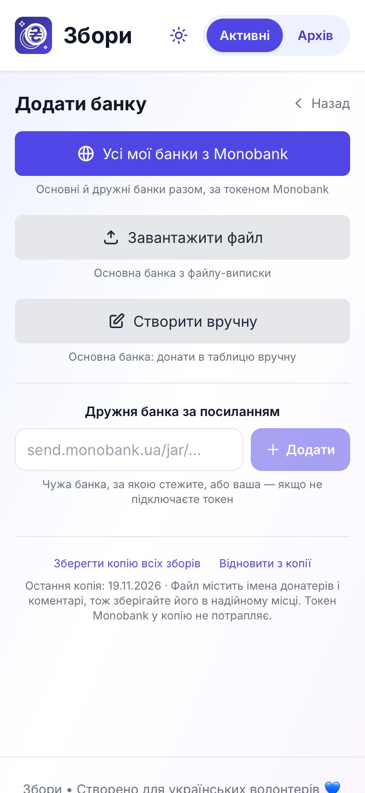

### Спосіб А. Усі мої банки з Monobank

Потрібен персональний токен. Отримати його легко — і це займає хвилину:

1. Відкрийте <https://api.monobank.ua/> та увійдіть через застосунок monobank.
2. Скопіюйте персональний токен, який покаже сайт.

Далі в «Збори»: **«Додати банку» → «Усі мої банки з Monobank»**.

  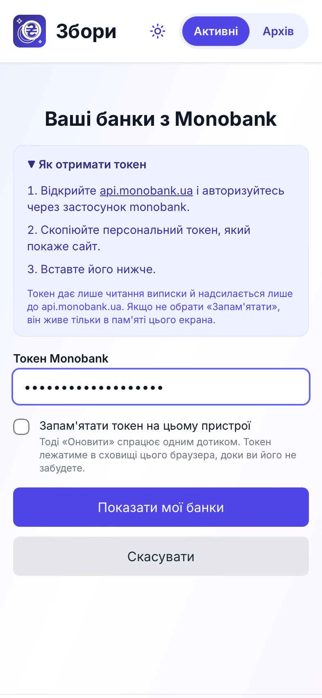
  &nbsp;
  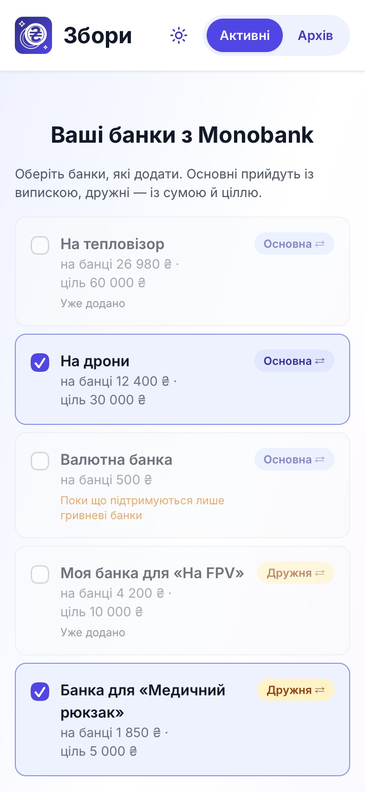
  &nbsp;
  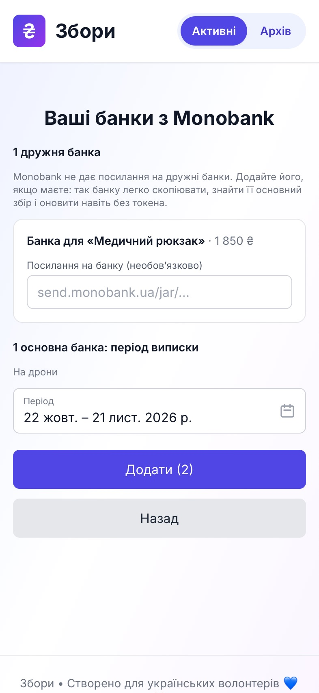

1. Вставте токен і натисніть **«Показати мої банки»**.
2. Ви побачите **усі свої банки**, кожна з міткою **«Основна»** або **«Дружня»**. Мітку підказує Monobank: у дружньої банки немає власного посилання. Якщо мітка хибна, торкніться її, щоб змінити. Банки, які вже є в застосунку, позначені **«Уже додано»** або **«Уже в архіві»**; банки не в гривні видно, але вибрати їх не можна.
3. Позначте **одну чи кілька** банок і натисніть **«Далі»**.
4. **Для дружніх банок** можна вставити посилання (`send.monobank.ua/jar/…`), якщо воно у вас є: Monobank не дає посилання на дружні банки, а з ним банку легко скопіювати, знайти збір, який вона поповнює, і оновити навіть без токена. Якщо таку саму банку (та сама назва й ціль) ви вже додали за посиланням, застосунок запропонує **об'єднати** їх в одну — ваша назва, посилання й історія лишаються.
5. **Для основних банок** оберіть період виписки (за замовчуванням — останні 30 днів).
6. Натисніть **«Додати»**. Дружні банки додаються одразу; виписки основних — по черзі.

Одна основна банка — і ви одразу на її аналітиці. Кілька — і вони з'являться в «Активних».

**Варто знати:**

- **Токен передається тільки до `api.monobank.ua`.** Без позначки **«Запам'ятати токен на цьому пристрої»** він живе лише в пам'яті й зникає разом з екраном. З позначкою він лежить у сховищі цього браузера, і **«Оновити»** спрацьовує одним дотиком; кнопка **«Видалити токен»** — у блоці загальної суми на аналітиці. На спільному пристрої не запам'ятовуйте токен: він дає читання виписок вашого акаунта.
- Monobank дозволяє **одну виписку на хвилину** і до 31 дня за запит, тому кілька банок або довгий період завантажуються частинами, з видимим відліком. Ви можете зупинитися будь-коли.
- **Дружні банки Monobank показує без донатів** — лише суму й ціль. Окремі донати з'являться, якщо додати виписку від підтримки банку ([розділ 11](#11-закрити-збір-і-архів)).
- «Monobank не прийняв токен» — скопіюйте його ще раз повністю, без зайвих символів.
- «Monobank просить зачекати» — ви натрапили на ліміт запитів. Застосунок сам чекає хвилину між запитами; в іншому разі спробуйте ще раз за хвилину.
- «За цей період донатів не знайшлося» — оберіть інші дати, ширший період.

### Спосіб Б. CSV-виписка

1. Отримайте виписку своєї банки у форматі **CSV** або **Excel** (.xls, .xlsx) (у застосунку monobank; якщо не виходить, виписку можна запросити в підтримці monobank — застосунок розуміє обидва формати).
2. Натисніть **«Завантажити файл»** і виберіть файл.

### Спосіб В. Вручну

Натисніть **«Створити вручну»** й заповніть таблицю: дата, час, імʼя, сума.

### Спосіб Г. Дружня банка за посиланням

Внизу екрана «Додати банку» вставте посилання на дружню банку (`send.monobank.ua/jar/…`) і натисніть **«Додати»**. Підходить для чужої банки, за якою ви стежите, або для своєї, якщо не хочете підключати токен. Якщо ця банка вже прийшла з Monobank без посилання (та сама назва й ціль), застосунок запропонує додати посилання до неї замість окремої банки.

---

## 3. Збір зберігається сам

Щойно дані завантажено, збір **автоматично зберігається** й відкривається аналітика — окремого кроку перегляду й кнопки «Зберегти» немає. Назва береться з банки або файлу (або з дат), її можна змінити: **«Редагувати» → «Перейменувати»**.

Мету, друзів і нові дані можна додати будь-коли через меню **«Редагувати»** (див. нижче). Якщо якісь рядки не вдалося розпізнати, на аналітиці буде попередження.

---

## 4. «Активні»: ваші банки

Усе, що триває, — на одному екрані, **на цьому пристрої**, у браузері: **«Основні збори»** зверху, **«Мої дружні банки»** під ними ([розділ 9](#9-мої-дружні-банки)). **«Додати банку»** — праворуч від першого заголовка.

  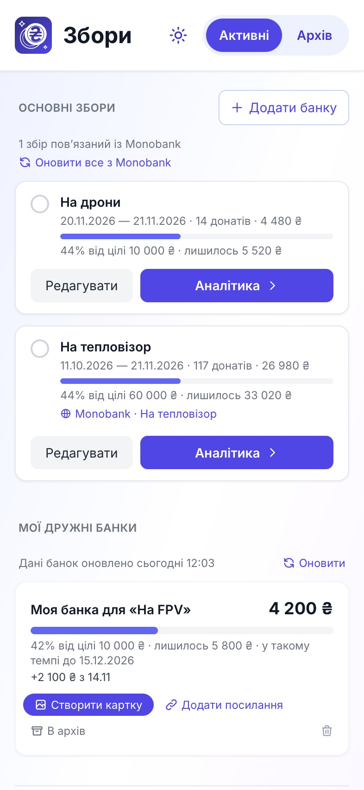
  &nbsp;&nbsp;
  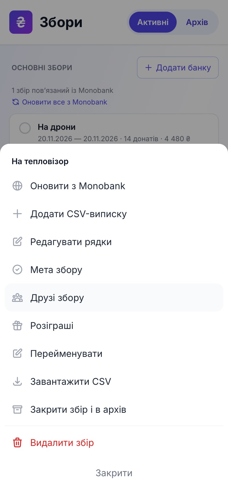

- У кожного збору з метою є **смуга прогресу**: скільки відсотків зібрано й скільки лишилось. Мета приходить із банки Monobank або задається в «Редагувати» → «Мета збору».
- **«Оновити все з Monobank»** над списком читає виписки всіх основних зборів, прив'язаних до Monobank, по черзі (виписка на хвилину), і додає нові донати. Якщо токен не запам'ятовано, застосунок його попросить.
- **«Аналітика →»** — одразу на аналітику, зі збереженою метою, друзями, фоном і стилем.
- **«Редагувати»** відкриває меню, і кожен пункт — це окремий екран саме для цієї дії:
  - **Оновити з Monobank** — відкриває аналітику й одразу підтягує нові донати; **Додати дані з Monobank** — прив'язує збір до банки;
  - **Додати CSV-виписку** — додати ще один файл;
  - **Редагувати рядки** — правити таблицю;
  - **Мета збору** — змінити або прибрати мету;
  - **Друзі збору** — банки помічників;
  - **Розіграші**;
  - **Закрити збір і в архів** ([розділ 11](#11-закрити-збір-і-архів));
  - **Перейменувати** і **Завантажити CSV** — копія даних файлом;
  - **Видалити збір**.
- Усе зберігається одразу. Якщо нові рядки схожі на вже наявні, але не збіглися з ними, застосунок попередить про можливе задвоєння й дасть **«Скасувати оновлення»**.

> ⚠️ Збори лежать у браузері цього пристрою. Якщо очистити дані сайту або зайти з іншого пристрою, їх там не буде. Унизу «Активних» і «Архіву» є **«Зберегти копію всіх зборів»**: один файл з усім — активні й закриті збори, дружні банки з їхніми виписками, друзі з історією сум, мета, стиль, відповіді про ціль. **«Відновити з копії»** повертає все з файлу на будь-якому пристрої: відсутні збори додаються, а новіші версії на пристрої не перезаписуються. У файлі є імена донатерів і коментарі, тож зберігайте його надійно; токен Monobank у нього не потрапляє. Теми оформлення до копії не входять.

**Кілька зборів разом.** Позначте кілька зборів кружечками й натисніть **«Аналізувати разом (N)»** — тоді з'являться порівняння між зборами та звіти за період.

---

## 5. Аналітика

  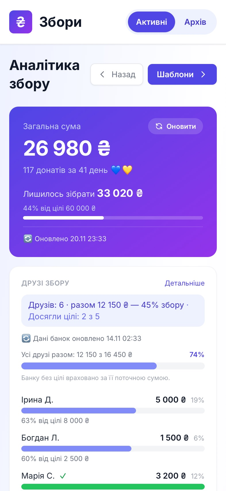
  &nbsp;
  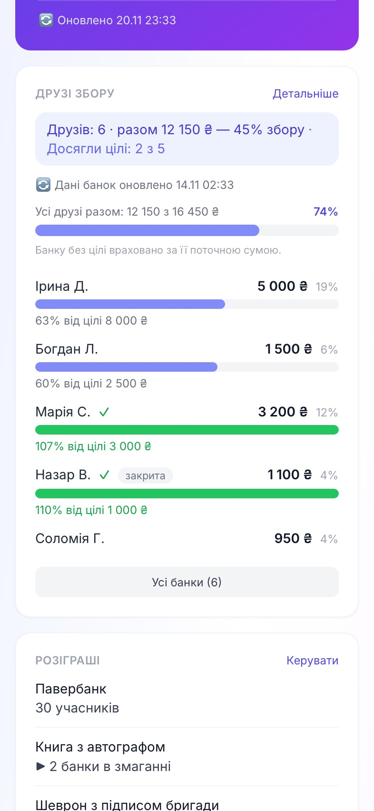
  &nbsp;
  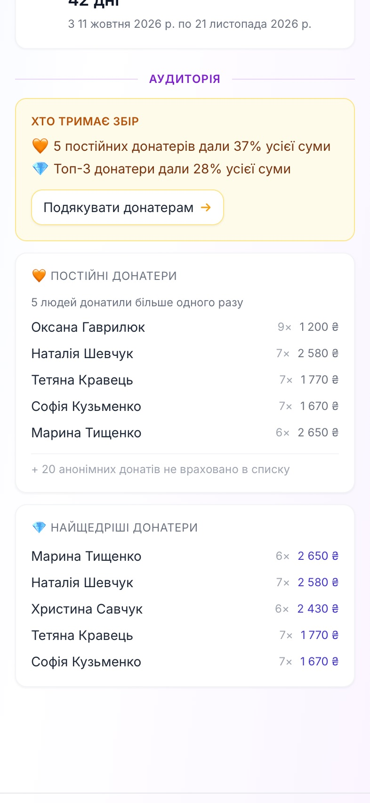

  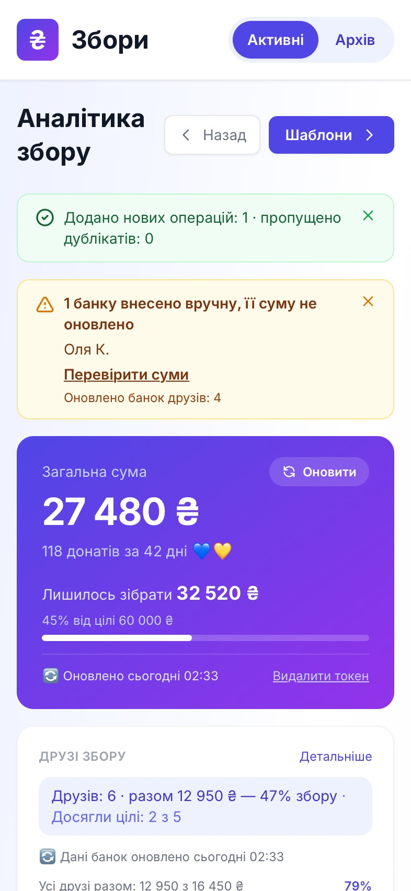
  &nbsp;
  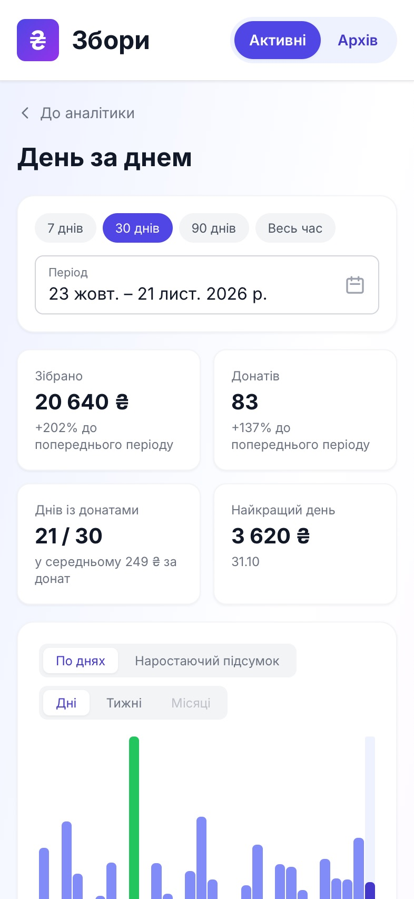
  &nbsp;
  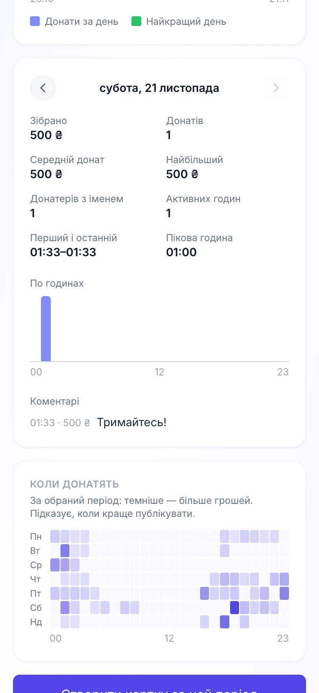

Що ви побачите:

- **Загальна сума**, кількість донатів і тривалість (скільки днів ішов збір; один день — це 1 день). Для збору, прив'язаного до Monobank, тут є кнопка **«Оновити»**. Вона одна на всю сторінку: разом підтягує донати головної банки від останнього дня в зборі до цього моменту й суми всіх прив'язаних банок друзів і зберігає все одразу, а нижче видно час останнього оновлення. Банки, внесені вручну, застосунок прочитати не може, тож після оновлення він назве їх і запропонує перевірити суми. Якщо токен не запам'ятовано, застосунок попросить його. Якщо збір давно не оновлювали, це кілька запитів із паузою в хвилину.
- **Ціль досягнуто** — коли збір зібрав свою мету, зверху з'явиться пропозиція закрити його й перенести в архів (або нагадати пізніше).
- **Друзі збору** — прогрес кожної банки до її мети; зверху смуга «Усі друзі разом: X з Y ₴»: усе, що зібрали друзі, відносно сумарних цілей (банка без цілі враховується за своєю сумою; смуга ховається, доки ні в кого немає цілі, а відсоток може перевищувати 100%). На аналітиці видно п'ять останніх змінених банок; **«Детальніше»** відкриває сторінку з усіма. Див. [розділ 8](#8-дружні-банки-друзі-збору).
- **Графік донатів за день** (до 30 останніх днів). **«Детальніше»** відкриває сторінку **«День за днем»**: будь-який період (7, 30, 90 днів, весь час або свої дати) у порівнянні з попереднім таким самим; стовпчики або наростаючий підсумок. Стовпчик — це **день, тиждень або місяць**: до 31 дня — дні, до трьох місяців — тижні, довше — місяці; перемикач **«Дні · Тижні · Місяці»** показує, що зараз, і дозволяє обрати інше (те, що не вміщається, неактивне). Натисніть на стовпчик, щоб побачити подробиці: для дня — суму, донатерів, години й коментарі; для тижня чи місяця — підсумок, дні з донатами й найкращий день, а **«Відкрити … по днях»** покаже їх по днях. Нижче — карта **«Коли донатять»** за днями тижня й годинами і кнопка **«Створити картку за цей період»**. Блок «На рахунку» зʼявляється тільки коли були зняття коштів або повернення.
- **Розіграші** — якщо ви їх додали: приз і хто вже бере участь. Див. [розділ 10](#10-розіграші).
- **Картки-підказки:** типовий донат, найкращий день, час активності.
- **«Аудиторія»:** хто тримає збір — скільки відсотків суми дали постійні донатори й топ-3, кнопка **«Подякувати донатерам»** веде до шаблону подяки; також найпопулярніші емоджі та списки постійних і найщедріших. Анонімні донати враховані в сумі, але не потрапляють до списків.

Далі — кнопка **«Шаблони»**, а **«Назад»** повертає до списку зборів.

---

## 6. Шаблони

  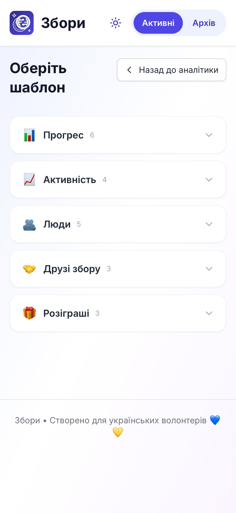
  &nbsp;&nbsp;
  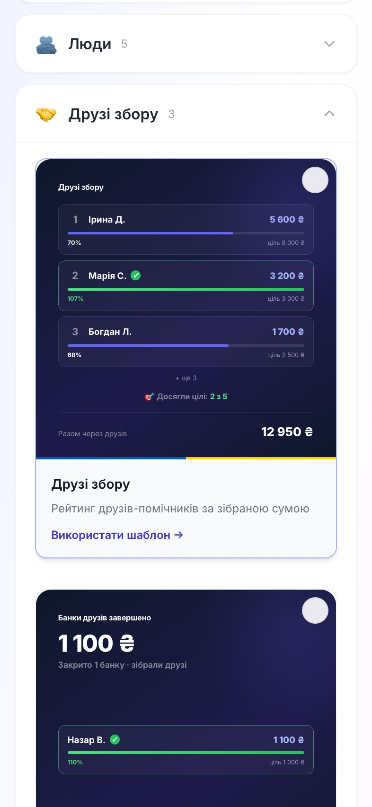

Шаблони розкладені за групами: **Прогрес**, **Активність**, **Люди**, **Друзі збору**, **Розіграші** та **Звіти**. Групи згорнуті: торкніться назви, щоб відкрити. Шаблони друзів і розіграшів з'являються, коли є дані для них. Для закритих зборів і для року в архіві є окремі групи — **«Підсумок»** і **«Мій рік»** ([розділ 11](#11-закрити-збір-і-архів)).

У групі «Активність» є картка **«Який донат типовий»**: медіана, найчастіший, середній, найбільший і найменший донат, де лежить половина всіх донатів і розподіл за сумою.

- Торкніться картки, щоб відкрити її в редакторі.
- Можна відкрити **кілька шаблонів** і зробити **серію**: усі картки матимуть спільний фон і стиль.
- **«Назад до аналітики»** — повернутися.

---

## 7. Відредагуйте й завантажте картинку

  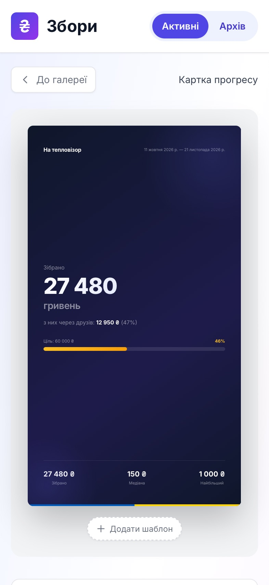
  &nbsp;&nbsp;
  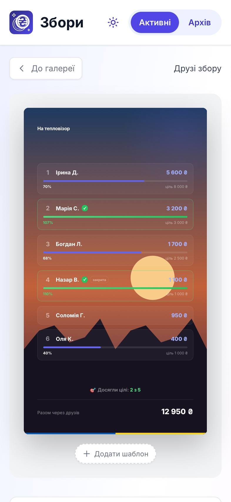
  &nbsp;&nbsp;
  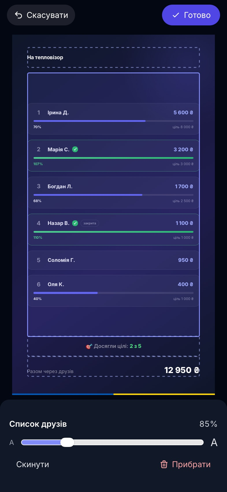

Редактор показує картку у зменшеному вигляді, а в результаті ви отримаєте файл **1080 пікселів** завширшки. На телефоні картка зменшується, коли ви гортаєте вниз, щоб звільнити місце для налаштувань. **«До галереї»** повертає до шаблонів.

### Основне

- **Формат:** пост 1:1, пост 4:5 або сторіс 9:16.
- **«Редагувати елементи»** — картка відкривається на весь екран. Торкніться елемента, щоб змінити розмір його тексту (від 50% до 200%) або прибрати його. **«Скасувати»** крок за кроком повертає і розміри, і прибрані елементи. **«Розмір тексту»** у панелі змінює весь текст картки і діє разом із розміром окремих елементів.
- **«Редагувати текст»** — змініть підписи й заголовки.
- Якщо серія з кількох карток, у блоці **«Свій стиль для цієї картки»** можна відв'язати поточну картку від спільного стилю.
- **«Додати шаблон»** — додати ще одну картку до серії.
- **Діапазон дат** (для шаблонів, де він підходить) — показати лише частину збору.

### Власний фон

  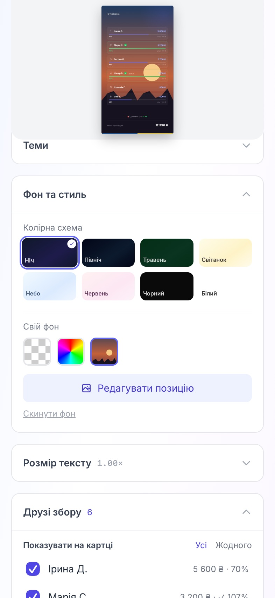
  &nbsp;&nbsp;
  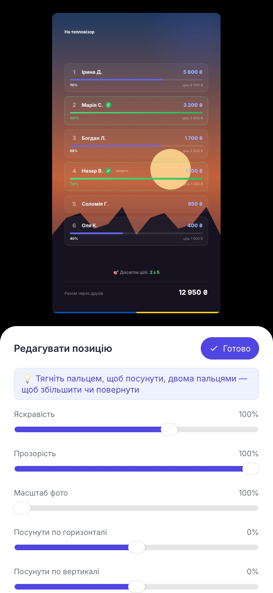

1. Відкрийте **«Фон та стиль»**, оберіть кольорову палітру або **«Свій фон»**: прозорий, колір чи **фото**.
2. Для фото натисніть **«Редагувати позицію»**: відкриється повноекранний редактор. **Одним пальцем** перетягуйте фото, **двома** — збільшуйте й повертайте. Нижче — яскравість, прозорість, масштаб і зсув. Сторінка при цьому не гортається, фото не зсувається випадково.
3. Натисніть **«Готово»**.

> Великі фото з телефона автоматично зменшуються до 3000 пікселів, цього достатньо для чіткої картинки.

### Теми

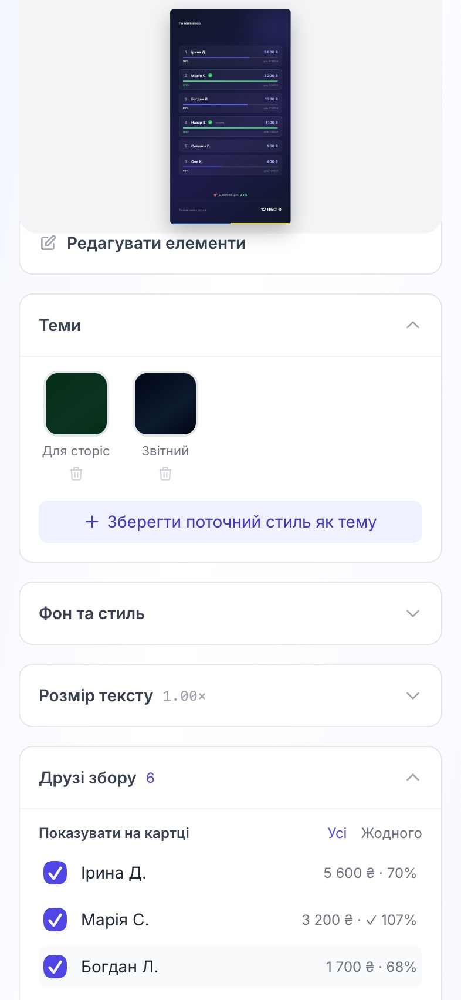

Знайшли вдалий вигляд? Збережіть його як **тему**: **«Теми» → «Зберегти поточний стиль як тему»**. Потім її можна застосувати до будь-якого збору. Тема — це копія: якщо ви потім зміните чи видалите тему, картки, де вона вже застосована, не зміняться. Якщо ви трохи підправили стиль, натисніть **«Оновити тему»**, щоб записати зміни в неї.

### Завантаження

- **«Завантажити PNG»** — одна картка.
- **«Завантажити всі · ZIP»** — вся серія одним архівом.
- На **iPhone** файл відкриється в меню «Поділитися»: оберіть **«Зберегти зображення»**.

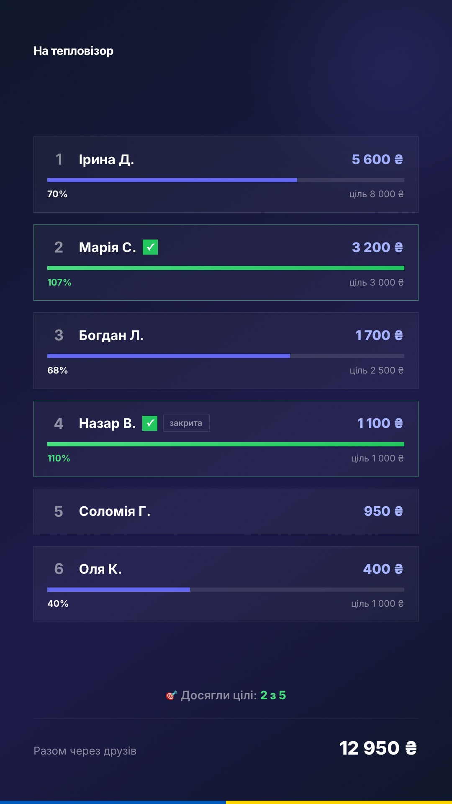

---

## 8. Дружні банки (друзі збору)

У monobank помічники можуть відкривати **власні банки**, що наповнюють вашу. Ці гроші **вже входять** у вашу виписку, але без підпису, хто саме їх приніс. Додайте їх — і отримаєте рейтинг, окрему сторінку з усіма банками, графіки й картки.

> 💡 Це лише **підпис «хто допоміг»**: суми друзів **ніколи не додаються** до загальної суми й не змінюють її. Ваші власні дружні банки для чужих зборів — це інше, див. [розділ 9](#9-мої-дружні-банки).

### Як додати

Відкрийте **«Редагувати» → «Друзі збору»** або **«Додати дружні банки»** на аналітиці.

  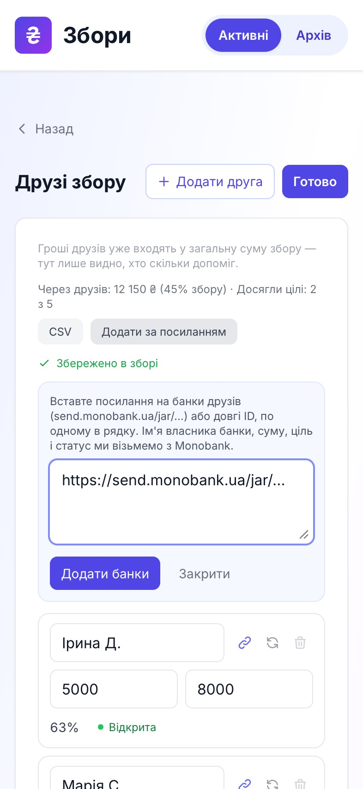
  &nbsp;
  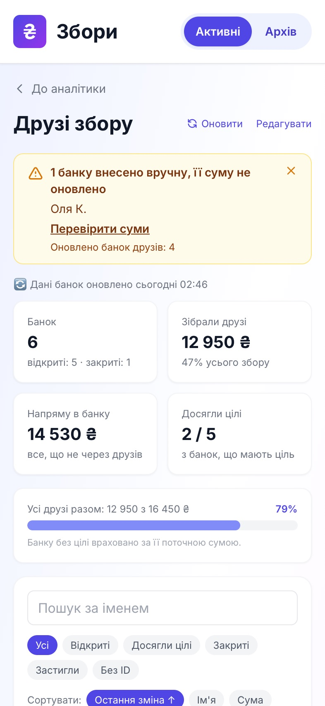
  &nbsp;
  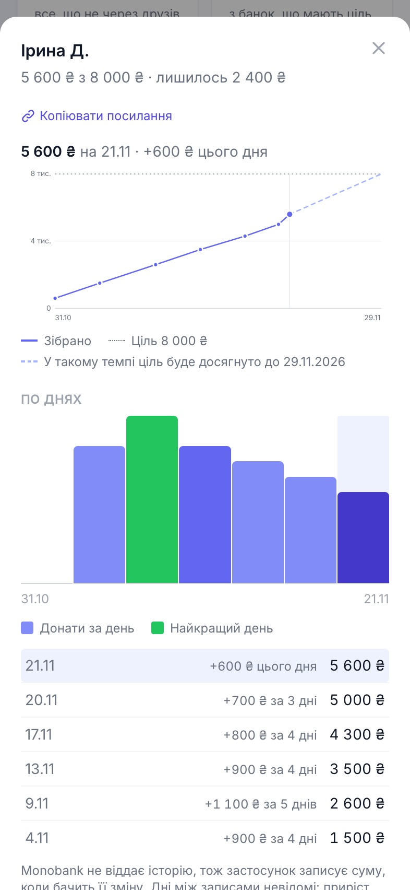

**Найпростіше — за посиланням.** **«Додати за посиланням»**: вставте посилання на банки друзів (`https://send.monobank.ua/jar/…`), по одному в рядку. Ім'я, суму, ціль і статус застосунок візьме з Monobank.

**Вручну.** Якщо посилання немає: **«Додати друга»** вгорі сторінки (нові рядки з'являються зверху), вкажіть **ім'я або назву**, **«Зібрано, ₴»** і, за бажання, **«Ціль, ₴»**.

**Усе зберігається само**: за мить після змін, а також коли ви оновлюєте банки чи йдете зі сторінки. Біля заголовка видно «Зберігаю…» / «Збережено в зборі», а рядки, змінені відтоді, як ви відкрили сторінку, позначені **«Новий»** або **«Змінено»**. Заголовок і кнопки **«Додати друга»** та **«Готово»** лишаються під рукою, коли гортаєте довгий список.

Суму банки, внесеної вручну, застосунок оновити не може. Після **«Оновити»** він назве такі банки, щоб ви перевірили суми.

Правила:

- **Імена мають бути різними** (великі й малі літери та зайві пробіли не враховуються). Поки два імені збігаються, поля підсвічені червоним і список не зберігається; якщо спробуєте піти, застосунок запропонує **виправити ім'я** або **вийти без цих змін**.
- На аналітиці друзі лише для перегляду: підсумок і п'ять останніх змінених банок. **«Детальніше»** відкриває сторінку **«Друзі збору»**: пошук за іменем, фільтри (відкриті, досягли цілі, закриті, застигли, без ID), сортування, скільки лишилось до цілі, зростання, прогноз дати за поточним темпом, час останньої зміни, перемикач **«Оновлювати при відкритті»**, **CSV** і кнопка **«Редагувати»**. Натисніть на банку, щоб побачити її графік: як сума зростала до цілі, куди веде поточний темп і скільки додалось у кожен записаний день. З перемикачем застарілі дані оновлюються самі, але тільки повністю: якщо потрібен токен, а його не запам'ятовано, або оновлення не вміщається в один запит, застосунок чекатиме на вашу кнопку.
- **Історія сум.** Monobank не віддає історію, тому застосунок записує суму щоразу, як вона змінилась, не частіше ніж раз на день. Зростання й прогноз стають точнішими, якщо оновлювати банки частіше, а дні без оновлень об'єднуються в один крок. «Застигла» — відкрита прив'язана банка без змін 5 днів і довше. Щоб не забувати, увімкніть **«Щоденне нагадування»** внизу сторінки друзів: оберіть час (з кроком 15 хвилин) і додайте подію в календар, а календар нагадуватиме щодня. Щоб змінити час, спершу видаліть стару подію; щоб вимкнути — просто видаліть її.

### Таблиця друзів

Кожен друг — окремий рядок: **ім'я**, **зібрано**, **ціль**, **% від цілі** і **статус** («Відкрита» / «Закрита»); праворуч — кнопки оновлення (якщо банку прив'язано) та видалення. **«Копіювати посилання»** біля банки копіює її посилання.

### Прив'язати банку друга

Вставте звичайне **посилання на банку** (`https://send.monobank.ua/jar/…`), яке вам надіслав друг, один раз: іконка ланцюжка → **«Прив'язати банку»**. Воно збережеться разом із другом. Застосунок додає лише банки, які поповнюють головну банку цього збору: головну банку чи банку іншого збору він не прийме, навіть за довгим ID. Далі:

- **«Оновити»** на аналітиці або на сторінці друзів читає всі прив'язані відкриті банки разом із головною. Якщо Monobank попросить зачекати, застосунок ще раз спробує ті банки, які не встиг прочитати, і скаже, що не вдалося;
- кнопка оновлення в рядку редактора читає одну банку;
- **«Додати за посиланням»** створює друзів одразу з кількох вставлених посилань. Ім'я друга береться з імені власника банки.

Ручні правки не губляться: оновлення міняє суму й статус, а ім'я та ціль, які ви ввели самі, лишаються (порожня ціль підставляється з мети банки, а порожнє ім'я — з імені власника банки). **Статус** («Відкрита» / «Закрита») — це перемикач у кожному рядку: так можна вручну позначити банку закритою (прив'язана банка, яку Monobank показує закритою, перемикається сама, і її можна відкрити знову). Закриті банки оновлення пропускають, але їх можна редагувати вручну. Деталі прив'язки (ID, коли востаннє читали, «Відв'язати») відкриваються іконкою ланцюжка в рядку.

> ⚠️ Це неофіційна можливість Monobank: вона може обмежувати кількість запитів або змінитися. Вручну вводити суми можна завжди.

#### Якщо посилання не спрацювало: довгий ID банки

Пошук за посиланням проходить через наш невеликий сервіс і неофіційну функцію Monobank, тож може тимчасово не працювати. Сервіс нічого не зберігає й не бачить ні виписки, ні токена. Якщо він недоступний, можна вставити довгий ID вручну.

Довгого ID **не видно ні в застосунку monobank, ні на самій сторінці банки** — його треба «витягнути» зі службової відповіді сторінки. Це робиться **один раз для кожної банки**, краще **на комп'ютері** (на телефоні інструменти розробника незручні). Це не складно, якщо діяти за кроками:

1. Відкрийте в браузері на комп'ютері **публічне посилання на банку друга** — те, що він вам надіслав: `https://send.monobank.ua/jar/…`.
2. Відкрийте **інструменти розробника**: натисніть **F12** (або **Ctrl+Shift+I**; на Mac — **⌥⌘I**). У Safari спершу ввімкніть меню «Розробка» в *Параметри → Додатково*. Перейдіть на вкладку **Network** («Мережа»).
3. Не закриваючи панель, **оновіть сторінку** (F5) і введіть у поле фільтра слово `handler`.
4. Натисніть на запит **`handler`** (це запит `POST` на `send.monobank.ua/api/handler`; якщо їх два — підійде будь-який) і відкрийте вкладку **Response** («Відповідь») або **Preview**.
5. Знайдіть у відповіді поле **`extJarId`** — довгий рядок із літер і цифр, приблизно 32 символи, наприклад `3xpbdqzsr7At11TZ9UPtsXneijoi61K2`. **Скопіюйте лише це значення** (без лапок).
6. Вставте його в рядок друга: іконка ланцюжка → **«Прив'язати банку»**, або в **«Додати за посиланням»** (можна вставити кілька, по одному в рядку). Підійде також повне посилання `https://api.monobank.ua/bank/jar/<ID>`.

Там само у відповіді є `ownerName` (ім'я власника банки) і `mainJar` (до якої банки вона належить) — зручно перевірити, що ви взяли ID потрібної банки. Якщо запиту `handler` не видно, сторінка могла змінитися — тоді просто вводьте суми вручну.

### Ціль друга

Якщо в друга є ціль, його смужка показує **власний прогрес** («зібрано / ціль»), а не порівняння з найбільшим. Можна перевиконати: смужка заповнюється повністю, пишеться справжній відсоток (наприклад, **140%**), а біля імені з'являється зелена **галочка ✓**. Якщо цілі немає ні в кого, смужки порівнюють друзів між собою.

### На картці

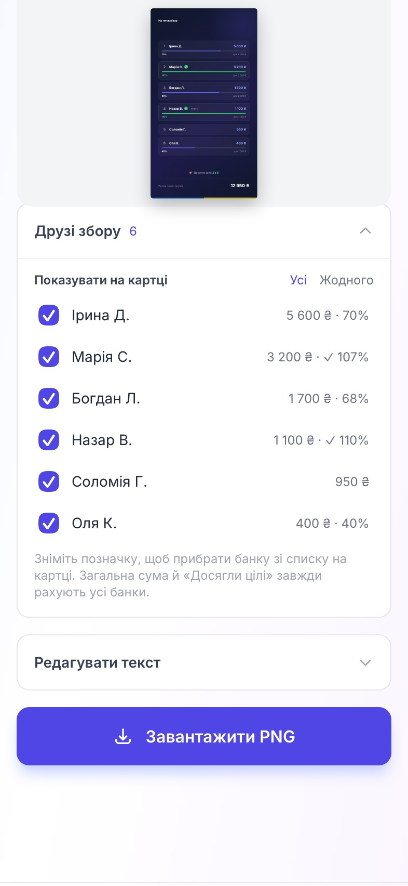

У шаблонах групи «Друзі збору» є таблиця лідерів, картка «Банки друзів» (скільки банок, спільна ціль, зібрано й смуга прогресу) і **«Завершені банки друзів»** — підсумок лише закритих банок: скільки зібрано разом, кожна банка з фінальною сумою, галочка біля тих, що досягли цілі, і рядок подяки. Цей шаблон з'являється, коли є хоча б одна закрита банка із сумою; у таблиці лідерів закриті банки отримують позначку «закрита». У редакторі таблиці лідерів і завершених банок є список **«Показувати на картці»**: ставте й знімайте позначки, щоб обрати, хто потрапить на картку (**«Усі»** / **«Жодного»**). Дані друзів при цьому не змінюються. Сума й рядок «Досягли цілі: 2 з 3» завжди рахують усі банки, навіть ті, яких немає в списку.

---

## 9. Мої дружні банки

Якщо ви самі ведете дружню банку для чужого збору, Monobank не кладе її донати у вашу виписку. Такі банки — у розділі **«Мої дружні банки»** в «Активних».

- **Додати:** **«Додати банку» → «Усі мої банки з Monobank»** — ваші дружні банки прийдуть із міткою «Дружня», із сумою й ціллю ([розділ 2](#спосіб-а-усі-мої-банки-з-monobank)). Або **за посиланням** внизу екрана «Додати банку» — тоді застосунок прочитає назву, суму, ціль, статус і збір, який банка поповнює.
- **Оновити:** кнопка **«Оновити»** спершу читає ваші банки через Monobank за вашим токеном (одним запитом), а решту — за посиланнями. Якщо токена немає або Monobank не відповів, банки з посиланням оновляться за посиланням, і застосунок напише, що так сталося, кого не вдалося оновити й кнопку **«Ввести токен»**. Коли ви відкриваєте «Активні», банки, які давно не оновлювались, оновлюються самі.
- **Закрита в Monobank:** закриту банку Monobank більше не показує, тож застосунок позначить її **«закрита»** і запропонує перенести в архів.
- **«Додати посилання»** — для банки, що прийшла з Monobank без посилання: так її можна скопіювати, знайти її основний збір і оновлювати без токена.
- **Що видно:** сума, відсоток від цілі й скільки лишилось, приріст за тиждень і прогноз, а для банки з посиланням — основний збір: назва, власник і скільки зібрано разом. Натисніть на банку, щоб побачити графік.
- **Картки:** **«Створити картку»** відкриває шаблони, що працюють лише із сумою та ціллю: **«Моя дружня банка»** (ваша сума, ціль, збір, якому ви допомагаєте, і посилання) та шаблони прогресу. У «Заклику до дії» і «Скільки залишилось» посилання на вашу банку вже вставлено.
- **«В архів»** — коли банка закрилась або досягла цілі ([розділ 11](#11-закрити-збір-і-архів)).

Окремих донатів Monobank для дружніх банок не дає, тож аналітики донатерів і коментарів тут немає — доки ви не додасте виписку від підтримки банку в архіві. Історію суми застосунок збирає сам під час кожного оновлення, тому вона з'являється з дня, коли ви додали банку.

---

## 10. Розіграші

Якщо ви розігруєте призи, додайте їх: **«Редагувати» → «Розіграші»** або **«+ Додати розіграш»** на аналітиці. Застосунок лише показує, хто бере участь. Сам розіграш проводиться окремо, наприклад у сервісі Monobank.

  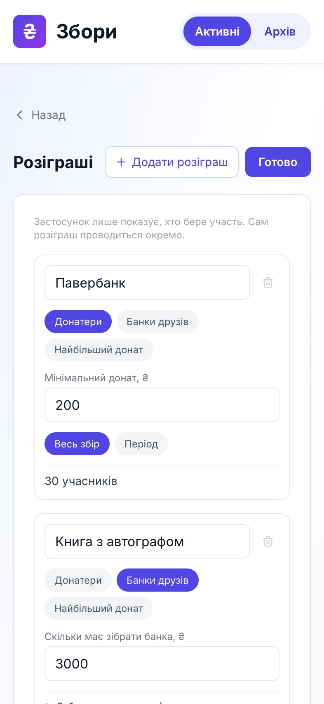
  &nbsp;&nbsp;
  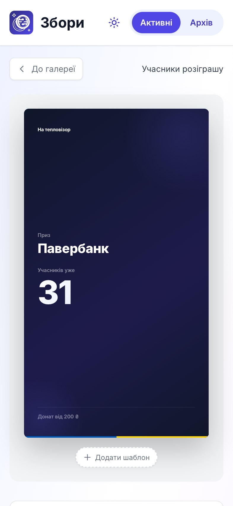

Для кожного призу оберіть, хто бере участь:

- **Донатери.** Вкажіть мінімальний донат (або залиште порожнім). Донати людини з іменем додаються, і вона рахується один раз: 150 + 150 ₴ проходять у розіграш від 200 ₴. Анонімні донати не додаються: кожен рахується окремо й має сам досягти мінімуму.
- **Банки друзів.** Вкажіть, скільки має зібрати банка (або залиште порожнім: тоді беруть участь усі банки, що щось зібрали). Натисніть на рядок із кількістю, щоб побачити список банок.
- **Найбільший донат.** Застосунок покаже найбільшу суму й скільки людей мають рівно стільки. Для людини з іменем береться сума всіх її донатів. Імен на картці немає.

Для донатерів і найбільшого донату можна обрати **весь збір** або **період**, навіть один день. Усе зберігається автоматично.

У шаблонах з'явиться група **«Розіграші»** з трьома картками. Якщо розіграшів одного типу кілька, оберіть потрібний у редакторі картки. Числа рахуються за випискою головної банки, тож оновлюйте збір перед публікацією.

---

## 11. Закрити збір і архів

Коли збір завершився, закрийте його: він переїде в **«Архів»** з усім, що в ньому було, — випискою, друзями, розіграшами, стилем карток — і лишиться там лише для перегляду, розкладений за роками.

### Закрити збір

**«Редагувати» → «Закрити збір і в архів»** або **«Закрити збір і перенести в архів»** на аналітиці, коли ціль досягнуто.

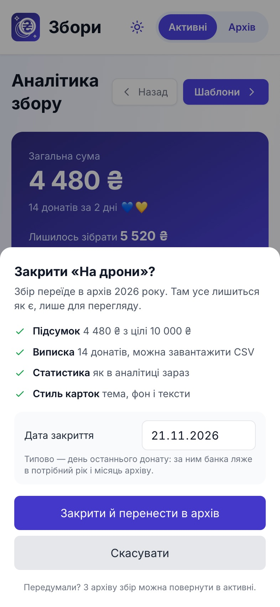

- **Дата закриття** — за замовчуванням день останнього донату: за ним збір ляже в потрібний рік і місяць архіву. Її можна змінити.
- **«Ціль збору досягнуто?»** — якщо мети в застосунку не було, скажіть, чи досягли ви цілі: так «Мій рік» правильно порахує досягнуті цілі. Якщо мета є, це видно з чисел.
- **«Спершу оновити все з Monobank»** — для прив'язаного збору: останнє оновлення перед закриттям, щоб підсумок був точним.
- Якщо у вас є свої дружні банки для цього збору, їх можна закрити разом із ним.

Свою дружню банку закрийте кнопкою **«В архів»** у «Моїх дружніх банках» — там так само дата закриття й питання про ціль.

### Архів

  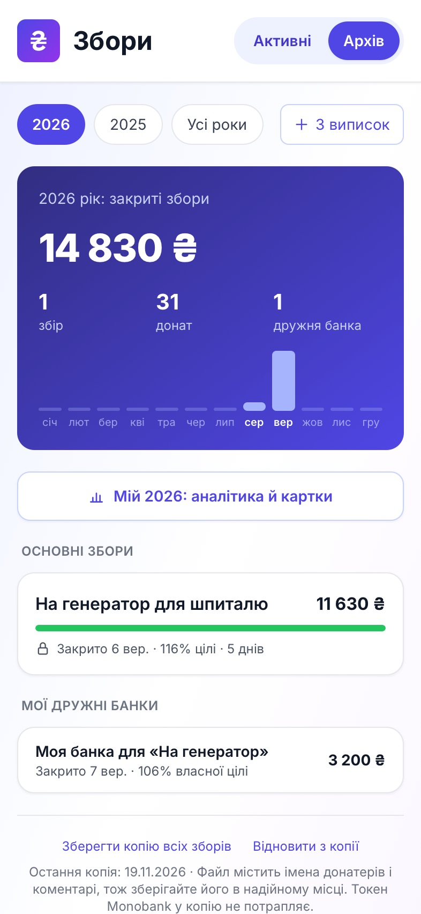
  &nbsp;
  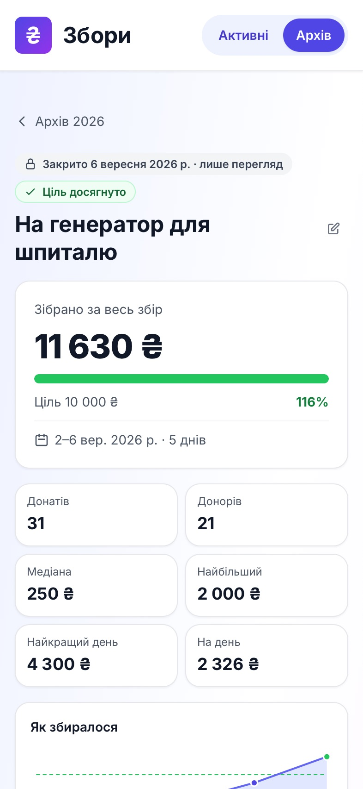
  &nbsp;
  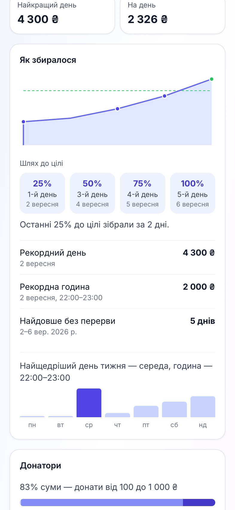

- **Роки** вгорі (і «Усі роки»). Картка року: скільки зібрали всі закриті за рік збори й ваші дружні банки, скільки зборів і донатів, **ваші** дружні банки (банки помічників ваших зборів сюди не входять), і стовпчики за місяцями — скільки грошей прийшло в кожен місяць.
- Нижче — **«Основні збори»** і **«Мої дружні банки»** цього року, з пошуком і сторінками, якщо їх багато.
- **Сторінка закритого збору:** підсумок і мета, позначка **«Ціль досягнуто» / «Ціль не досягнуто»**, головні числа, **«Як збиралося»** (шлях до цілі: коли зібрали чверть, половину й усе, рекордний день і година, дні поспіль, коли донатили найщедріше), **«Донатори»** (розмір донатів, хто повертався, топ, коментарі), друзі збору, рух коштів, порівняння з іншими закритими зборами, розіграші.
- **Завантажити:** фінальну виписку (CSV), друзів (CSV) і **повну копію збору** (JSON — її приймає «Відновити з копії»).
- **«Зробити картку-підсумок»** відкриває шаблони з групою **«Підсумок»**: «Збір завершено», «Як ми збирали», «Збір у цифрах», «Наші донатори» (імена можна прибрати), друзі й рух коштів.
- **Олівець біля назви** — перейменувати (зручно для назв із файлу на кшталт «Jar_statement_…»).
- **«Повернути в активні»** — якщо закрили зарано. **«Видалити з архіву»** — назавжди, після підтвердження.

### Виписка для дружньої банки

Monobank не дає донатів дружньої банки, але **виписку можна запросити в підтримці банку**. На сторінці закритої дружньої банки натисніть **«Додати виписку (CSV)»** — і з'являться донати, донори, графіки, картки-підсумки, а банка повністю врахується в «Мій рік». Якщо сума у виписці не збігається із сумою банки, застосунок покаже обидві суми й різницю.

### Закриті банки з виписок

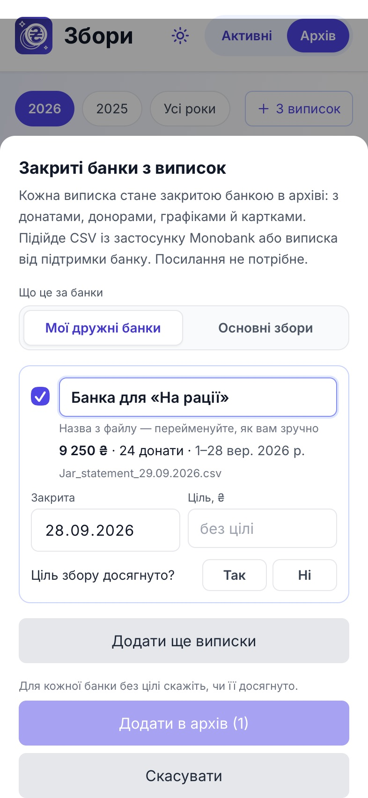

Старі банки, яких не було в застосунку (наприклад, давні дружні банки без посилань), можна додати просто в архів: **«З виписок»** угорі архіву.

1. Оберіть одну чи кілька виписок (CSV з застосунку Monobank або від підтримки).
2. Вкажіть, що це за банки: **«Мої дружні банки»** чи **«Основні збори»**.
3. Для кожної перевірте **назву** (вона береться з назви файлу — перейменуйте), **дату закриття** (за замовчуванням останній донат) і **ціль**; якщо цілі немає — скажіть, чи її досягнуто.
4. Виписка, яка вже є в застосунку, буде позначена й не додасться, якщо ви її не позначите.

### Мій рік

  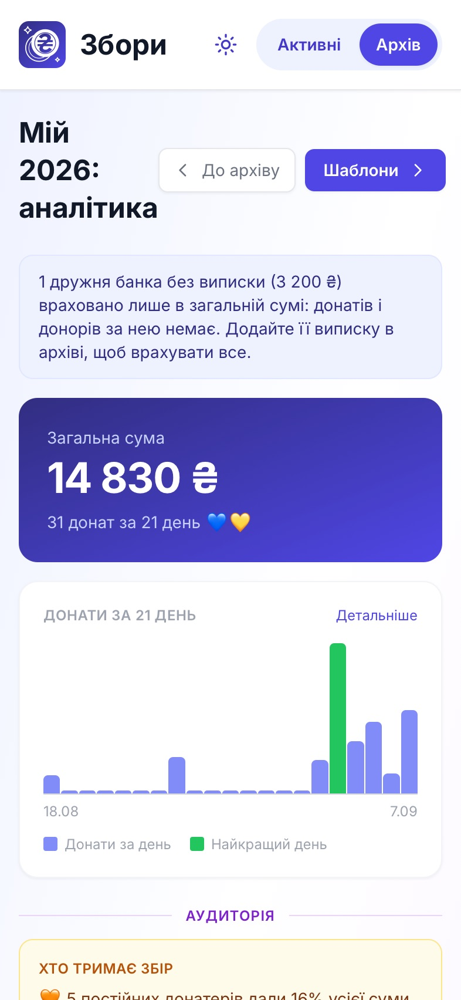
  &nbsp;
  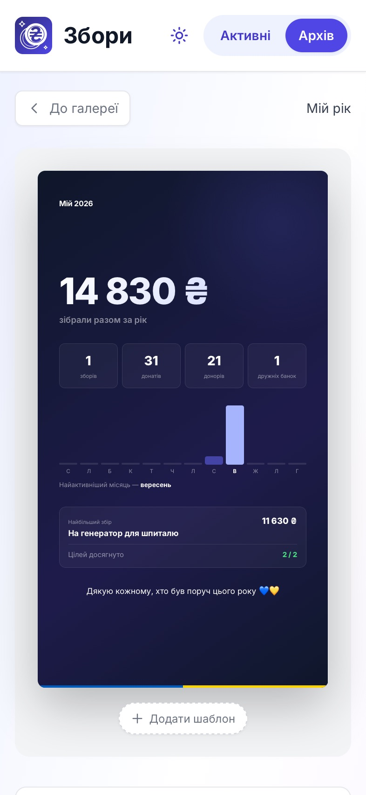

Під карткою року — **«Мій 2026: аналітика й картки»**. Спершу — аналітика року: усі закриті за рік збори й ваші дружні банки разом, порівняння зборів, «День за днем». Дружні банки без виписки враховано лише в сумі (без донатів і донорів), і застосунок про це пише. Далі **«Шаблони»** → група **«Мій рік»**: картка **«Мій 2026»** (сума за рік, збори, донати, донори, дружні банки, місяці, найбільший збір і скільки цілей досягнуто), загальний звіт, порівняння зборів, «Збір у цифрах» і «Наші донатори» за весь рік.

Якщо деякі закриті збори не мали мети й ви ще не казали, чи досягли цілі, застосунок спершу запитає про них.

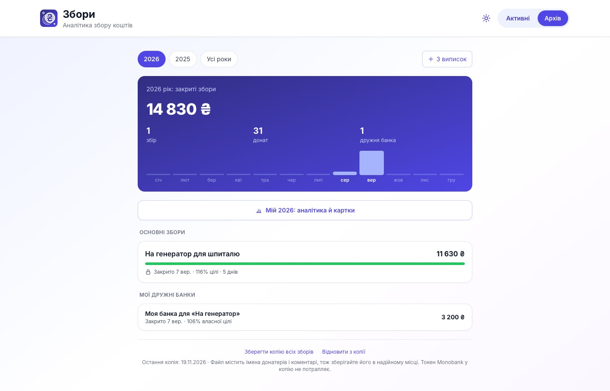

---

## 12. Часті запитання та проблеми

**Чи безпечно вводити токен Monobank?**
Токен дає лише читання виписки й надсилається тільки на `api.monobank.ua`. Застосунок зберігає його лише якщо ви самі обрали **«Запам'ятати токен на цьому пристрої»**, і лише в цьому браузері; **«Видалити токен»** прибирає його. Нікому не пересилайте свій токен і не публікуйте його в скриншотах.

**Чому збори зникли?**
Збори зберігаються в браузері. Їх не буде після очищення даних сайту, в іншому браузері або на іншому пристрої. Робіть копію: **«Зберегти копію всіх зборів»** унизу «Активних» або «Архіву».

**Чому дружня банка без посилання?**
Monobank не дає посилань на дружні банки, які приходять за вашим токеном. Додайте його самі: **«Додати посилання»** біля банки.

**Застосунок показує «Основна», а це дружня банка (або навпаки).**
Мітку підказує Monobank, і вона може помилятися. Торкніться її під час додавання, щоб змінити.

**Чому закритий збір опинився не в тому місяці?**
Збір лягає в архів за датою закриття, яку ви обрали (за замовчуванням — день останнього донату). Якщо дата хибна, поверніть збір в активні й закрийте знову з правильною датою.

**Час донатів інший, ніж у виписці.**
Застосунок показує час за **вашим годинником**, а файли CSV від Monobank завжди містять київський час. Якщо ви не в Києві, години можуть відрізнятися на різницю поясів — суми й дати від цього не змінюються.

**Донати задвоїлись після додавання даних.**
Такого не повинно бути: рядки, які вже є, розпізнаються й пропускаються. Якщо це сталося, напишіть нам (див. [відгук](#як-надіслати-відгук)) і прикладіть рядки, де помітили повтор, без імен донорів.

**На iPhone картка не завантажується.**
Файл має відкритися в меню «Поділитися» — обирайте «Зберегти зображення». Якщо не вийшло, повідомте нас, вказавши модель телефона й версію iOS.

**Фото на картці виглядає обрізаним.**
Відкрийте **«Фон та стиль» → «Редагувати позицію»** та підберіть масштаб і положення.

**Чому шаблон «Друзі збору» порожній?**
Спочатку додайте друзів (див. [розділ 8](#8-дружні-банки-друзі-збору)) — список зберігається сам.

**Чи можна автоматично отримати суми друзів із monobank?**
Так, якщо додати банку за посиланням: тоді **«Оновити»** читатиме її суму й статус. Офіційного способу немає, це неофіційна функція Monobank, тож вона може змінитися. Вручну вводити суми можна завжди (див. [розділ 8](#8-дружні-банки-друзі-збору)). Ваші **власні** дружні банки Monobank тепер віддає офіційно, за вашим токеном ([розділ 9](#9-мої-дружні-банки)).

**Чому банку не додано?**
У «Друзях збору» застосунок приймає лише банки, які поповнюють головну банку цього збору. Головну банку чи банку іншого збору він не додасть.

**Шрифт на картці в застосунку і на картинці різний.**
Таке могло бути в старіших версіях. Оновіть застосунок (банер «Нова версія»). Якщо це повторюється, напишіть нам.

---

## Що ми просимо перевірити під час бета-тесту

Не обов'язково все одразу — оберіть те, що вам ближче. Вкажіть у відгуку, **на якому пристрої й у якому браузері** ви пробували.

1. **«Додати банку» з Monobank:** отримали токен, побачили свої банки з мітками «Основна» / «Дружня», додали кілька. Чи правильні мітки? Чи зрозуміло з посиланнями й об'єднанням?
2. **Новий збір з CSV:** завантажили файл → опинилися на аналітиці. Усе зрозуміло?
3. **Збереження:** закрили вкладку, відкрили знову. Чи на місці дані, мета, друзі й розіграші? Спробуйте також копію всіх зборів і відновлення з неї на іншому пристрої.
4. **«Оновити» і «Оновити все з Monobank»:** із запам'ятаним токеном і без нього. Чи оновилися разом сума збору й банки друзів? А ваші дружні банки?
5. **«Редагувати»:** додавання CSV, зміна мети, перейменування. Чи завжди зрозуміло, де ви опинилися і як повернутись?
6. **Друзі збору:** додали банки за посиланням, спробували додати головну банку, додали друга вручну, подивились сторінку друзів і графік банки.
7. **Розіграші:** додали приз для донатерів, для банок і за найбільший донат, задали період. Чи збігається кількість учасників із вашими очікуваннями?
8. **Шаблони:** зробили картку зі своїм фото, серію з кількох карток, тему, змінили розмір окремих елементів. Чи можна було легко знайти, що змінити? Чи плавно зменшується картка при гортанні на телефоні?
9. **Завантаження:** PNG і ZIP — чи збереглося на вашому телефоні, чи виглядає як у редакторі?
10. **Закрити збір і архів:** закрили збір, подивились його сторінку в архіві, картку-підсумок, «Мій рік». Додали старі виписки через «З виписок». Чи правильні суми й місяці?
11. **Нагадування:** увімкнули щоденне нагадування на сторінці друзів. Чи додалася подія в календар?
12. **Загалом:** де ви застрягли? Що виглядало дивно? Чого вам не вистачило?

---

## Як надіслати відгук

Найкраще — завести запис на GitHub: <https://github.com/Yuliana7/zbory/issues> (кнопка **New issue**). Якщо там не зручно, надішліть відгук тому, хто запросив вас до тесту.

Що вказати:

- **Що ви робили** (кроки).
- **Що очікували** і **що вийшло**.
- **Скриншот** (за можливості; **без реальних імен донорів і без токена**).
- **Пристрій і браузер**, наприклад «iPhone 13, Safari».

Дякуємо, що допомагаєте зробити «Збори» кращими. 💙💛
